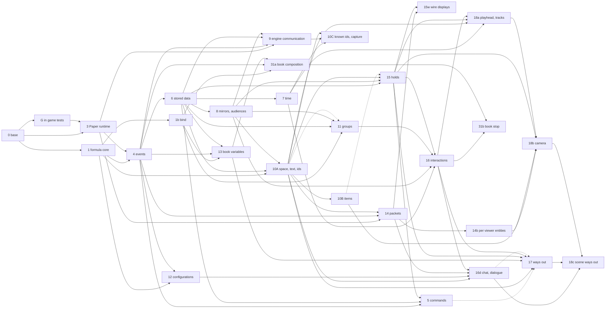

# Build graph

Which work can start once other work is done. It replaces the strict layer stack (2026-11-13): work with no path between it runs side by side, each node in its own thread and pull request. What each layer contains stays in the layer blocks of [closed-beta-roadmap.md](closed-beta-roadmap.md); this record decides order, needs, and status.

## Rules

- **Node ids** keep the layer numbers used across the records. A letter marks a part split from a layer (`10A`, `15w`); a `p` marks a layer's panel part (`9p`).
- **Start:** a node starts when every need is built. Built means merged into `features/v1`; a node branches from `features/v1`, never from another open pull request.
- **Edges:** a `hard` need is one the code cannot be written without. A `demo` need is one only the demo uses; the node's plan may change the demo to drop it, and says so.
- **In game tests:** every node whose demo has a real player needs `G`, because layers are built test first and the first failing test is an in game test with a real client. That is every Paper node, from 3 on; only 1b and the panel only nodes run without it.
- **Panel:** panel nodes wait on the panel redesign (`P`). A non panel node never waits on a panel node. A contract change in a non panel node still makes the Dart compile fixes that generated code forces, with no new UI.
- **Estimates:** the needs of nodes that have no rough design yet (19 to 30, conversion) are guesses from what other records assign to them; their rough design settles them.
- **Status values:** open, roughly designed, plan written, building, built.

## Graph

Dotted arrows are demo needs. `G` is drawn only into 3, since every Paper node reaches it through 3; the tables list it on each node. Panel nodes, estimated nodes, and the conversion track are in the tables below.

## Nodes

### Built and in progress

| Node | What | Needs | Status |
| --- | --- | --- | --- |
| 0 | Agent harness and test review (#542, #543, #546) | none | built (2026-11-05) |
| 1 | Formula core (#560) | 0 | built (2026-11-11) |
| P | Panel redesign: look, motion, and behavior (#548, #549) | none | building |
| G | In game testing with real clients (prototypes, `feat/game-verification-prototypes`) | 0 | building |

### Non panel

| Node | What | Needs | Runs in | Status |
| --- | --- | --- | --- | --- |
| 1b | `bind`: a generic parameter derived from content | 1 | realm, codegen | roughly designed |
| 3 | Paper runtime, sessions, `Engine` identity | 0, G | engine, realm | roughly designed |
| 4 | Event core: sources, verdicts, handlers, chains, delivery | 1, 3, G | engine, realm, codegen | roughly designed |
| 6 | Stored data: transactions, `Changes`, stored derives | 4, G | realm, engine, codegen | roughly designed |
| 7 | Time and reactions: `Due`, `Schedule`, `now`, `random`, `BoundPath` identity | 6, G | realm, engine, contract | roughly designed |
| 8 | Mirrors and audiences: `Live`, demand, `Health`, `Position`, `Watched<T>` and formula starts | 6, G | engine, realm | roughly designed |
| 9 | Engine communication: engine authoring writes, history and undo, `ContentDelivery`, `ChosenTarget`, `OnlinePlayer`, emit and results, the panel engine forwarder, the `WatchValues` server | 3, 4, 6, 8, G | realm, engine, contract | roughly designed |
| 10A | Space, text, and ids: the `Location` family, `Mirror<K, V>`, `RichText`, domain types and formula lookup, Paper events with their fields, the layer 10 actions | 1, 6, 8, G | engine, realm, codegen | roughly designed |
| 10B | Items and generation: both generators, the shape lock, item components, `CustomData`, version layers | 10A, G | codegen, engine | roughly designed |
| 10C | Known ids and capture: `KnownIds` reports, search, the domain check with stored reads in the query graph, capture | 7, 9, 10A, G | realm, engine | roughly designed |
| 11 | Groups, variables keyed by a group, `ContinueFor*` | 1b, 6, 8, G; demo 10A (world group) | engine, realm, codegen | roughly designed |
| 12 | Configurations: `Configuration<T>`, `Configured<T>`, `Partial<T>`, the merge at publish | 1, 4, G | realm, contract, codegen | roughly designed |
| 13 | Book variables, instances, thin copies, imports | 1b, 4, 6, G | realm, engine, codegen | roughly designed |
| 14 | Packets: `PaperWire`, wire sources and verdicts, version layers against Paper internals | 3, 4, 10A, G | engine, codegen | roughly designed |
| 14b | Base of per viewer entities: `FakeEntity` with spawn, move, remove, `lookThrough` | 14, G | engine | roughly designed |
| 15 | Holds: lifecycle, grace, adoption, priority, snapshots, input holds, and the displays without the wire (potion, boss bar, title, tab list) | 6, 8, 10A, G; demo 10B (spyglass) | engine, realm, codegen | roughly designed |
| 15w | Wire displays: sidebar and the action bar block | 14, 15, G | engine | roughly designed |
| 5 | Commands as holds, content commands, the wrap over other plugins, `/tw fire` | 4, 6, 15, G | engine, realm, codegen | roughly designed |
| 16 | Interactions core: steps, `StepRules`, `Running`, `Queued`, clashes, the queue, groups all or nothing, `Holder`, rejoin | 7, 8, 11, 15, G | realm, engine | roughly designed |
| 16d | Chat and dialogue: `ChatHold`, history, the hotbar wheel, key offers, `JumpLock`, the dialogue kinds | 10A, 12, 14, 16, G | engine | roughly designed |
| 17 | Ways out: `leavable`, `LeaveAsked`, leash, `HasAttributes`, `WayOut`, link fields as queries | 10A, 13, 15, 16, G; demo 5 (`/leave`), 16d (smith dialogue) | engine, realm, codegen | roughly designed |
| 18a | Scenes without the camera: `Playhead`, waits, `ScenePlaying`, potion, skip, and cue tracks, the layer 18 actions, `PlayerDamaged` | 7, 10A, 15, 16, G | realm, engine | roughly designed |
| 18b | Camera: `CameraHold`, segments and aim, the fake entity rig, `PaperEvents.own`, landing, `ClientLoaded`, the slots source | 10B, 14b, 15, 18a, G | engine | roughly designed |
| 18c | Scene ways out: `KeyWayOutEntry`, `NotReadyEntry`, `KeyOffer.press` | 16d, 17, 18b, G | engine | roughly designed |
| 31a | Book composition: conditions, inlets, outlets, `EmbedBook`, rewiring at publish | 1b, 4, 13, G | realm, engine, contract | roughly designed |
| 31b | Book stop: `BookGone`, the stop, `Queued.gaveUp` | 16, 31a, G | engine, realm | roughly designed |

### Panel

Each waits on `P`, and none blocks a non panel node.

| Node | What | Needs | Status |
| --- | --- | --- | --- |
| 2 | Var editor: plain and formula toggle, formula text editor, `WatchFormula`, type picker, template editor | 1, P | roughly designed |
| 6p | Variable editor, `WatchGuards`, the refused row | 2, 6 | roughly designed |
| 7p | Reaction and schedule editors | 2, 7 | roughly designed |
| 9p | Target picker, emit buttons with results, "applied on N of M", disabled reasons, the `WatchValues` client | 9, P, G | roughly designed |
| 10p | Domain value picker, per type editors, the Capture button | 2, 9p, 10C, G | roughly designed |
| 12p | The three level entry editor, `group` on a presentation, `NullableControl`, the `item` role summary | 2, 12 | roughly designed |
| 13p | Book variable type picker and instance editor | 2, 13 | open |
| 31p | The embed node with inlet and outlet slots | 2, 31a | open |

### Estimated

| Node | What | Needs (guessed) | Status |
| --- | --- | --- | --- |
| 19 | Debug and inspect (mostly beta panel views) | 6, 8, 9, 10A, 15, 16 | open |
| 20 | Assets and resource packs | 3, 9, 10A, G | open |
| 21 | NPCs and entities | 8, 10B, 11, 14b, 15, 16, 20, G | open |
| 22 | Regions and world rules; shape editing comes with 25 | 4, 8, 10A, G | open |
| 23 | Quests, objectives, compass and quest item | 5, 8, 15, 16, 17, G | open |
| 24 | Extension platform | 1, 4, 8, G | open |
| 25 | In game editor tools: waiting modes, handles, highlights, going to a value | 9, 10A, 10C, 14, 15, G | open |
| 26 | Road network | 21, 25; maybe 20, G | open |
| 27 | Visibility; may fold into 21 | 21, G | open |
| 28 | Migrations; its panel part needs 2 | 6, 7, 11, 13, 16, 31a | open |
| 29 | Importer 0.9: a skeleton first, then one converter per legacy kind once its target node is built | 9, then per kind | open |
| 30 | Production realm mode | 9, 20, 26, 28 | open |

Conversion track: weather, freeze time, and experience displays (15); Vault and PlaceholderAPI (24); RPGRegions (22, 24); Citizens (16, 21, 24); MythicMobs (18b, 21, 24); entity rest (21, 25); quest path objective (23, 26).

## Earliest start

Each wave can start once the nodes it needs are built, assuming enough threads. Waves count hard needs only; a node with a demo need either waits for it or changes its demo.

| Wave | Non panel nodes |
| --- | --- |
| now | 1b |
| after G | 3 |
| 1 | 4 |
| 2 | 6, 12 |
| 3 | 7, 8, 13 |
| 4 | 9, 10A, 11, 24, 31a |
| 5 | 10B, 10C, 14, 15, 20, 22, 29 (skeleton) |
| 6 | 5, 14b, 15w, 16, 25 |
| 7 | 16d, 17, 18a, 19, 21, 28, 31b |
| 8 | 18b, 23, 26, 27 |
| 9 | 18c, 30 |

The longest chain runs G, 3, 4, 6, 8, 10A, 15, 16, 18a, 18b, 18c. Panel nodes start when `P` is built: 2 and 9p first (9p also needs 9).

## What the split changed (2026-11-13)

- **Moved:** `bind` from 11 into 1b, because 11, 13, and 31a all use it and it needs only the formula core. `Watched<T>` and formula starts from 7 into 8, because `Watched<T>` is a `Live`. `KnownIds`, search, the domain check, and capture from 10A into 10C, because only they need 9; domain values are pure and engines bind them without `KnownIds` ([domains.md](domains.md#7-the-checker-types-the-formula)). The base of per viewer entities from 18 into 14b, so NPCs (21) do not wait on scenes. The slots source from 14 into 18b, its first user, so 14 needs no items.
- **Split:** 15 into holds with Paper displays and 15w with the wire displays; 16 into the interactions core and 16d chat and dialogue; 18 into 18a, 18b, and 18c; 31 into composition (31a) and the stop (31b); every layer's panel part into its own `p` node.
- **Dropped needs:** 9 on 2 (no `Var` or formula editor in engine communication); 12 on 11 and 2 (configurations use no groups; the editor is 12p); 15 on 12 (holds use no configuration); 17 on 14 and 12 (the leash uses Paper's API); 14 on all of 10 (only `RichText` and `Position` from 10A); 5 on 14.
- **Added needs:** 13 on 1b and 4; 16 on 7 (`now` and `StepContext.elapsed`); 16d on 12 (dialogue configurations) and 14 (`ChatSent` on the wire); 17 on 13 (`PublishScope` link queries) and 10A; 18a on 7 (`WaitDue` is a `Due`); 31a on 1b.

## Open

- `G` gates every Paper node, so its first build slice should be the smallest one that lets layer 3 write its failing test (a real client joins and the test reads what the server saw); the rest of `G` can grow beside the layers.
- Each split node's plan shapes its demo from the original layer demo; the original layer demos stay in the roadmap as the goal of all its parts together.
- The needs of the estimated nodes, and the per kind edges of 29.
